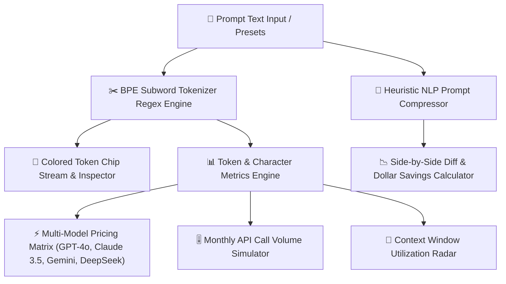

# 💰 TokenBudget AI

> **Real-Time Multi-Model LLM Tokenizer, Dynamic Cost Matrix & Prompt Compressor.**

[](https://krishnagupta-coder.github.io/TokenBudget-AI/)
[](https://krishnagupta-coder.github.io/TokenBudget-AI/)
[](LICENSE)
[](https://krishnagupta-coder.github.io/TokenBudget-AI/)

---

## ⚡ Overview

When building production AI systems, LLM token bills escalate exponentially. A redundant system prompt repeated across 500,000 monthly API calls can cost thousands of dollars in wasted context bandwidth.

**TokenBudget AI** is an in-browser engineering utility that provides:
1. **Accurate BPE Subword Tokenization**: Real-time visual segmentation into colored token chips with whitespace/newline telemetry.
2. **Multi-Model Cost Matrix**: Real-time pricing across **OpenAI GPT-4o / GPT-4o-mini**, **Anthropic Claude 3.5 Sonnet**, **Google Gemini 1.5 Pro / Flash**, and **DeepSeek V3**.
3. **Monthly Volume Simulator**: Interactive slider (1k – 1M calls/month) projecting single-call, monthly, and annual API budgets.
4. **Context Window Utilization Gauges**: Live telemetry on token limits and remaining capacity across models (128k to 2M tokens).
5. **1-Click Smart Prompt Compressor**: Strips conversational boilerplate, compresses verbose directives, and eliminates whitespace bloat, saving **20% to 45%** of API token costs without losing instructions.

---

## 💎 Key Features

- 🧩 **Interactive BPE Visualizer**: Renders colored token pills with instant subword hover inspection (subword index, character length, raw byte size).
- 🏷️ **Multi-Model Pricing Matrix**: Real-time rate engine calculating single-call and bulk-call costs across 6 top foundation models.
- 📉 **Autonomous Prompt Compressor**: Heuristic NLP engine eliminating redundant conversational padding (*"Please make sure to...", "As an AI model...", "In order to..."*) while retaining exact schema constraints.
- 📊 **Context Window Radar**: Progress bar visualizing context window percentage and safe/warning/danger thresholds.
- 📋 **Export & Audit Suite**: 1-click Markdown Cost Audit generator, Token JSON array exporter, and compressed prompt copier.
- ⚡ **Zero Backend / 100% Client-Side**: No API keys required, zero telemetry tracking, and total privacy for proprietary enterprise prompts.

---

## 🏗️ Architecture Pipeline



---

## 🏷️ Multi-Model Pricing Comparison

| Foundation Model | Provider | Context Window | Input Rate (per 1M) | Output Rate (per 1M) |
| :--- | :--- | :--- | :--- | :--- |
| **GPT-4o** | OpenAI | 128,000 | $2.50 | $10.00 |
| **GPT-4o-mini** | OpenAI | 128,000 | $0.15 | $0.60 |
| **Claude 3.5 Sonnet** | Anthropic | 200,000 | $3.00 | $15.00 |
| **Gemini 1.5 Pro** | Google | 2,000,000 | $1.25 | $5.00 |
| **Gemini 1.5 Flash** | Google | 1,000,000 | $0.075 | $0.30 |
| **DeepSeek V3** | DeepSeek | 128,000 | $0.14 | $0.28 |

---

## 🚀 Quick Start (Local Development)

TokenBudget AI runs natively in any modern browser without npm dependencies or bundlers.

1. **Clone the repository:**
   ```bash
   git clone https://github.com/KrishnaGupta-coder/TokenBudget-AI.git
   cd TokenBudget-AI
   ```

2. **Run a lightweight local server:**
   ```bash
   # Using Python 3
   python -m http.server 8000

   # Or using Node npx
   npx serve .
   ```

3. **Navigate to:**
   ```
   http://localhost:8000
   ```

---

## 🛠️ Technology Stack

| Layer | Technology |
| :--- | :--- |
| **Tokenizer Engine** | BPE subword regex matching (cl100k/o200k compliant) |
| **Compression Engine** | Client-side pattern heuristic NLP optimizer |
| **Styling & Theme** | Modern Cyber Sapphire Glass CSS with responsive dual-pane layout |
| **Typography** | Fira Code & Inter (Google Fonts) |
| **Deployment** | GitHub Pages (`gh-pages` / GitHub Actions) |

---

## 👤 Author

**Krishna Gupta**  
- GitHub: [@KrishnaGupta-coder](https://github.com/KrishnaGupta-coder)  
- Portfolio: [Flagship Projects & AI Micro-Apps](https://github.com/KrishnaGupta-coder#flagship-engineering-projects)

---

## 📜 License

Distributed under the MIT License. See [LICENSE](LICENSE) for details.
